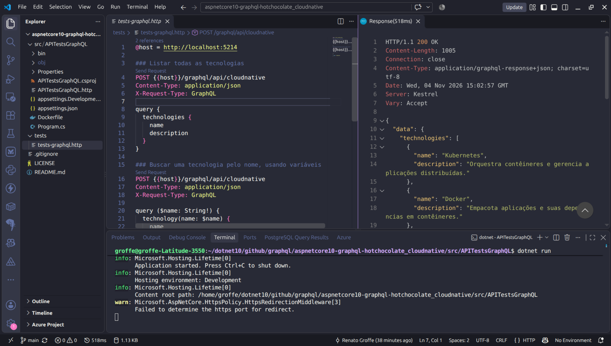
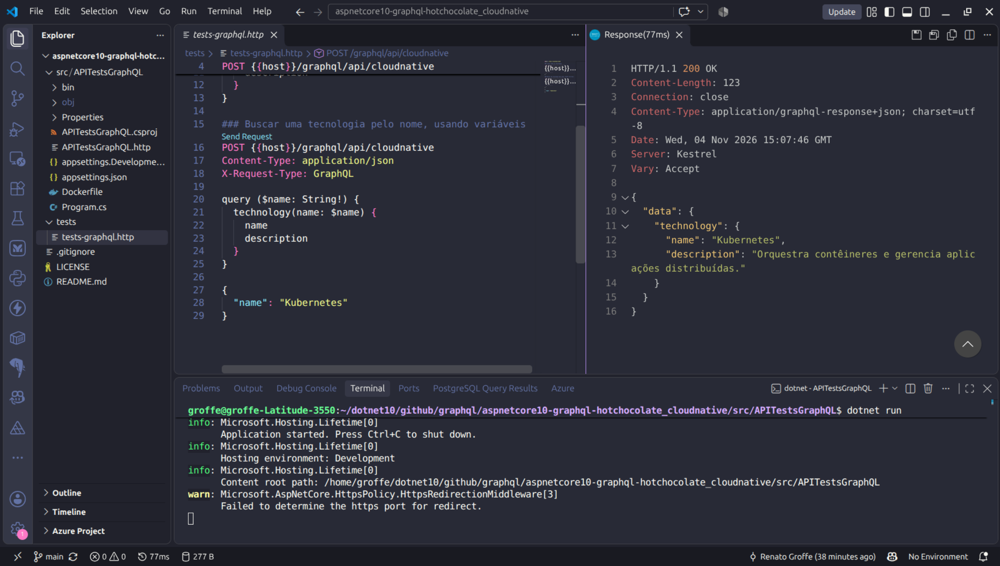
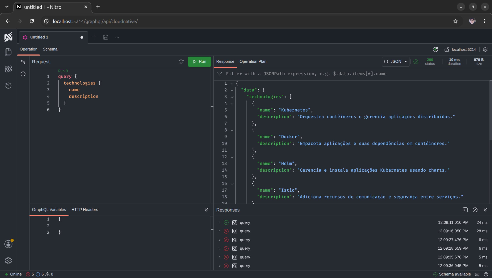

# aspnetcore10-graphql-hotchocolate_cloudnative
API REST criada com .NET 10 + ASP.NET Core + HotChocolate para consulta a informações sobre tecnologias cloud native. Inclui Dockerfile para build de imagens da aplicação.

## Testes

Um teste consultando todas as tecnologias via extensão **REST Client** no **Visual Studio Code**:

Um segundo teste consultando agora uma tecnologia específica (**Kubernetes**):

Consultando todas as tecnologias via interface **Nitro**:

